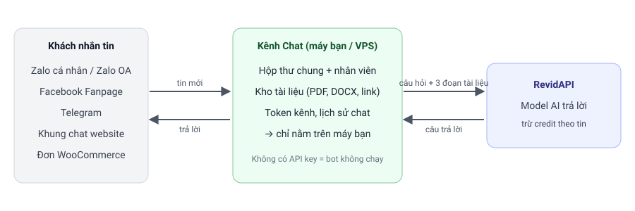
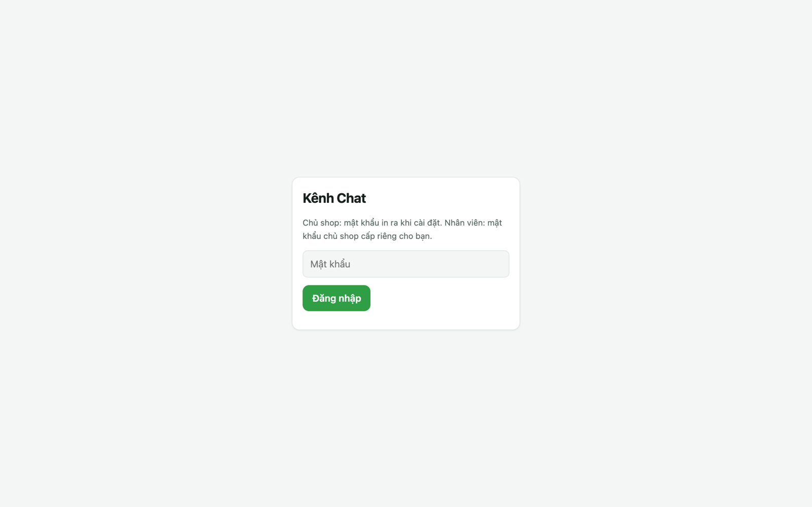
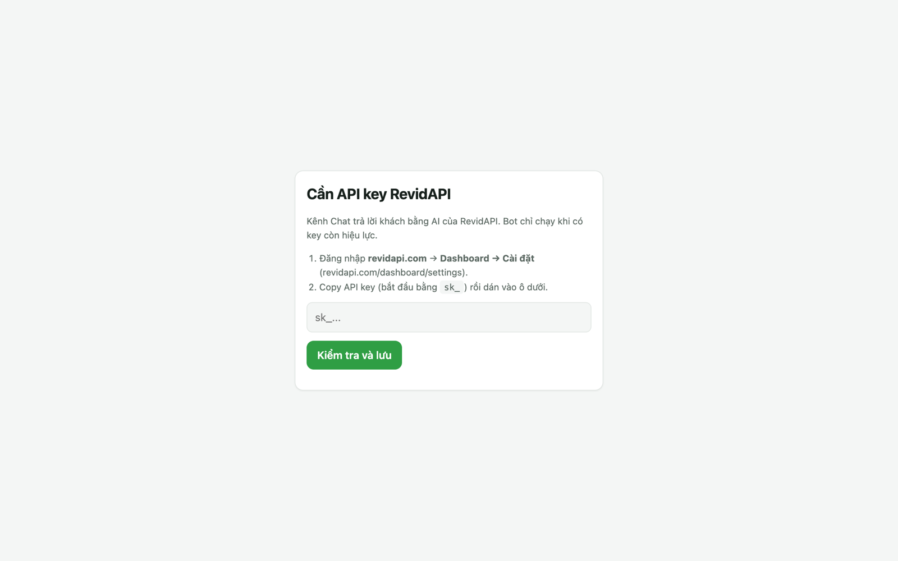
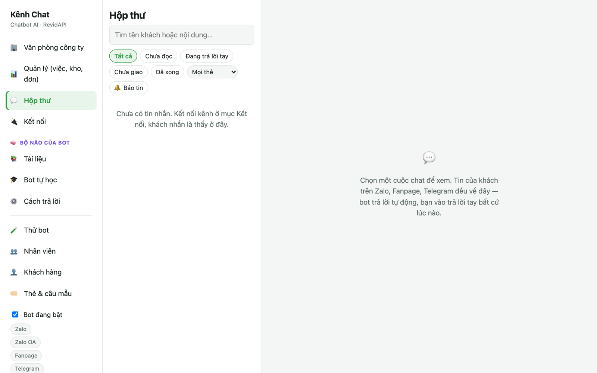
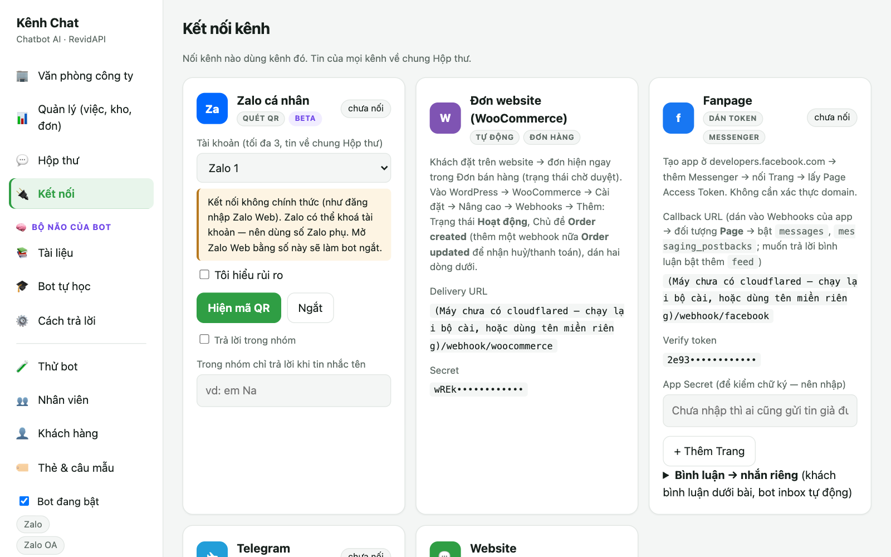
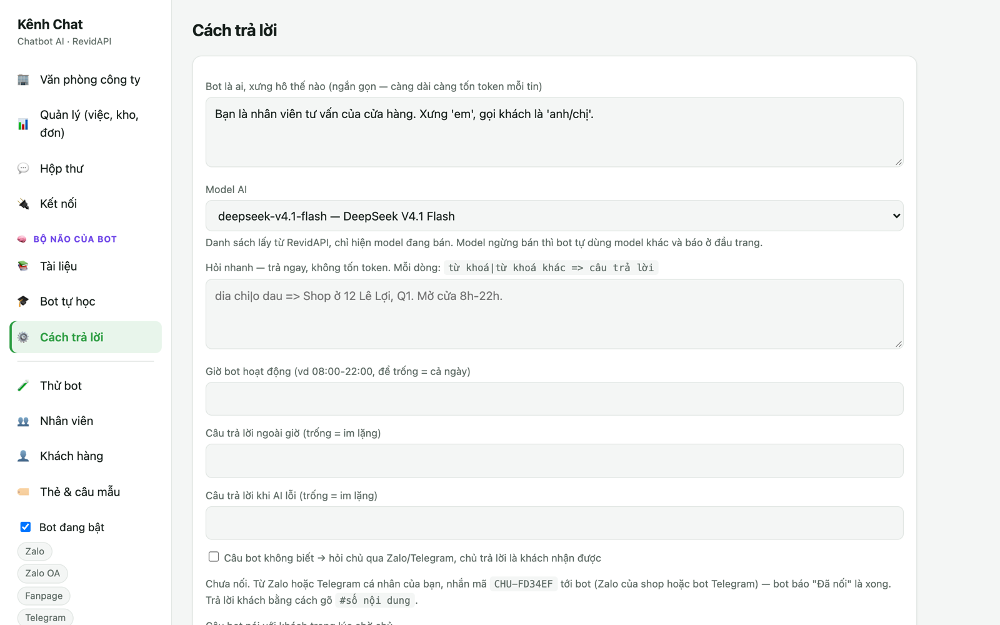
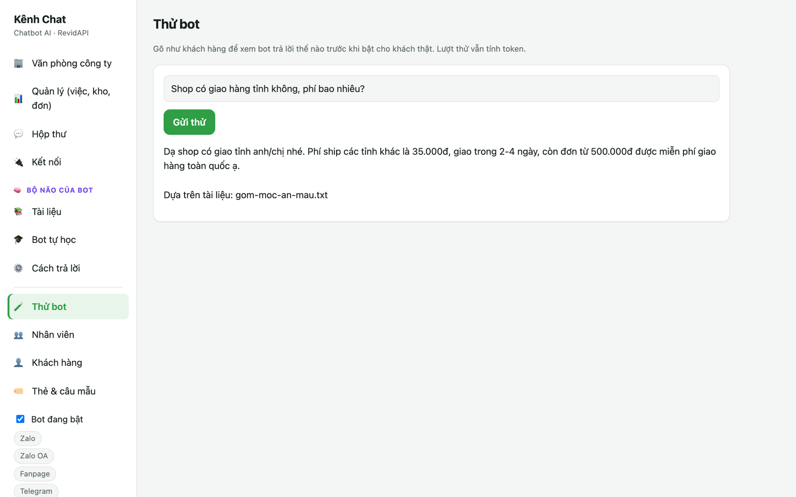
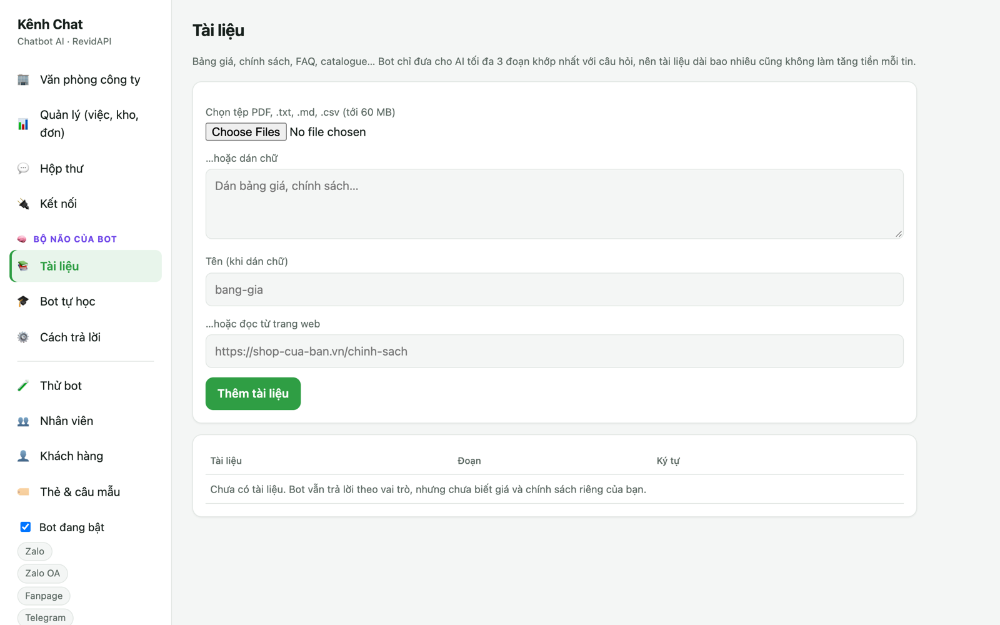
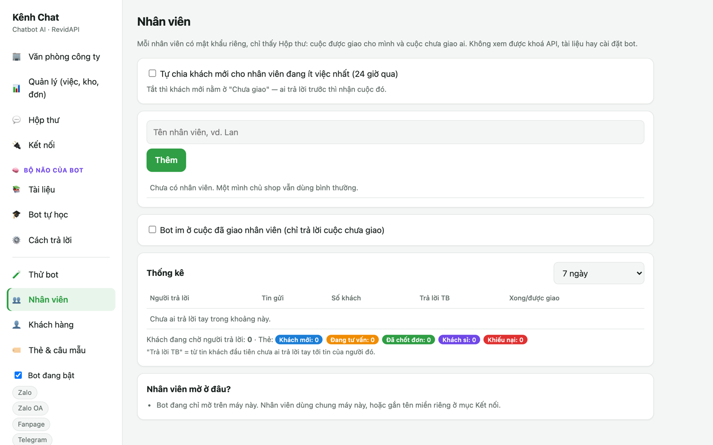

# RevidAPI Kênh Chat

Chatbot AI tự trả lời khách trên **Zalo cá nhân, Zalo OA, Facebook Fanpage, Telegram** và **khung chat website**, dựa trên tài liệu của shop (PDF, DOCX, TXT, link web). Chạy trên máy bạn hoặc VPS. AI trả lời qua [RevidAPI](https://revidapi.com).

> **Cần API key RevidAPI.** Mã nguồn mở để bạn tự cài, tự sửa, nhưng bot chỉ trả lời khi có key còn hiệu lực. Không có key thì trang quản trị dừng ở màn hình nhập key. Lấy key ở [revidapi.com/dashboard/settings](https://revidapi.com/dashboard/settings).

## Cài trong 5 phút

| Chạy ở đâu | Lệnh |
|---|---|
| VPS Ubuntu/Debian (24/7) | `curl -fsSL https://revidapi.com/tai-app/kenh-chat.sh \| sudo bash -s -- sk_khoa_cua_ban` |
| Mac | `curl -fsSL https://revidapi.com/tai-app/kenh-chat-mac.sh \| bash -s -- sk_khoa_cua_ban` |
| Windows (PowerShell) | `$env:REVIDAPI_KEY="sk_khoa_cua_ban"; irm https://revidapi.com/tai-app/kenh-chat-windows.ps1 \| iex` |
| Từ mã nguồn này | `npm install && npm start` |

Hướng dẫn từng bước có ảnh: **[docs/CAI-DAT.md](docs/CAI-DAT.md)**. Cách dùng từng tính năng: [HUONG-DAN.md](HUONG-DAN.md).

## Giao diện

| Đăng nhập | Nhập API key (bắt buộc) |
|---|---|
|  |  |

| Hộp thư chung mọi kênh | Kết nối kênh |
|---|---|
|  |  |

| Cách trả lời, chọn model AI | Thử bot trước khi bật |
|---|---|
|  |  |

| Tài liệu cho bot đọc | Nhân viên, chia khách |
|---|---|
|  |  |

## Tính năng

- **Hộp thư chung**: tin của mọi kênh về một chỗ. Chủ shop hoặc nhân viên nhảy vào trả lời tay bất cứ lúc nào, bot tự nhường.
- **Trả lời theo tài liệu**: tải bảng giá, chính sách, catalog; mỗi câu trả lời chỉ gửi kèm tối đa 3 đoạn liên quan nên tốn ít token.
- **Hỏi nhanh**: câu hỏi lặp lại (địa chỉ, giờ mở cửa) trả ngay, không tốn credit.
- **Nhân viên**: tạo tài khoản riêng, chia khách, gắn thẻ, câu mẫu, ghi chú.
- **Bot tự học**: câu bot không biết thì hỏi chủ qua Zalo/Telegram, chủ trả lời là khách nhận được và bot nhớ.
- **Đơn WooCommerce**: đơn mới hiện trong hộp thư, nhắn xác nhận cho khách.
- **Giờ hoạt động, câu ngoài giờ, chặn từng khách**.
- **Model AI chọn được**: danh sách lấy trực tiếp từ RevidAPI, model ngừng bán thì bot tự chuyển model khác và báo trên trang.

## Dữ liệu nằm ở đâu

Token Zalo/Facebook/Telegram, tài liệu và lịch sử chat **chỉ nằm trên máy chạy Kênh Chat** (thư mục `data/`, quyền 600). Mỗi lượt trả lời chỉ gửi lên RevidAPI: vai trò bot, 6 tin gần nhất và tối đa 3 đoạn tài liệu.

## Chi phí

Mỗi tin bot trả lời trừ credit theo model đã chọn (mặc định `deepseek-v4.1-flash`, rẻ nhất). Xem giá ở [revidapi.com](https://revidapi.com). Nên đặt trần chi tiêu theo ngày cho API key để bot không tiêu quá số bạn muốn.

> **Zalo cá nhân** dùng thư viện không chính thức `zca-js` (đăng nhập bằng QR như Zalo Web). Zalo có thể khoá tài khoản dùng tự động, nên dùng số phụ và không gửi hàng loạt. Zalo OA, Facebook, Telegram dùng API chính thức.

## Giấy phép

MIT, xem [LICENSE](LICENSE). Dịch vụ AI tính phí theo [điều khoản RevidAPI](https://revidapi.com).
