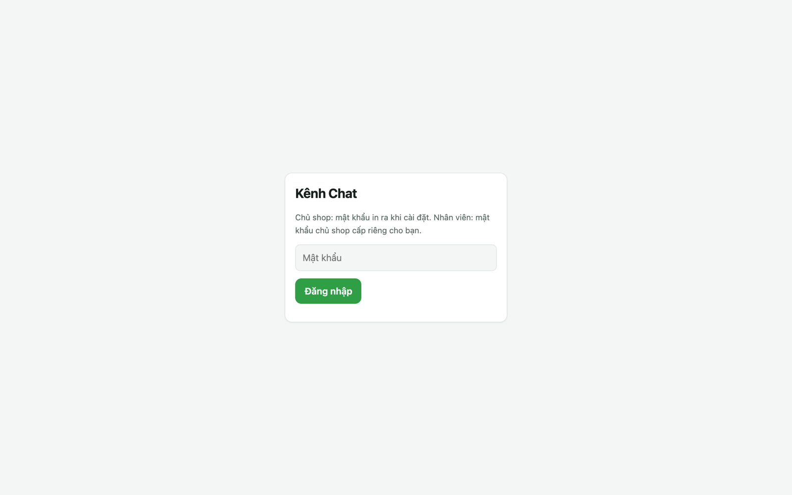
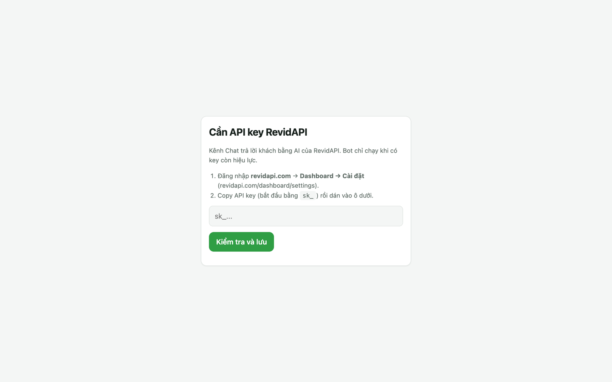
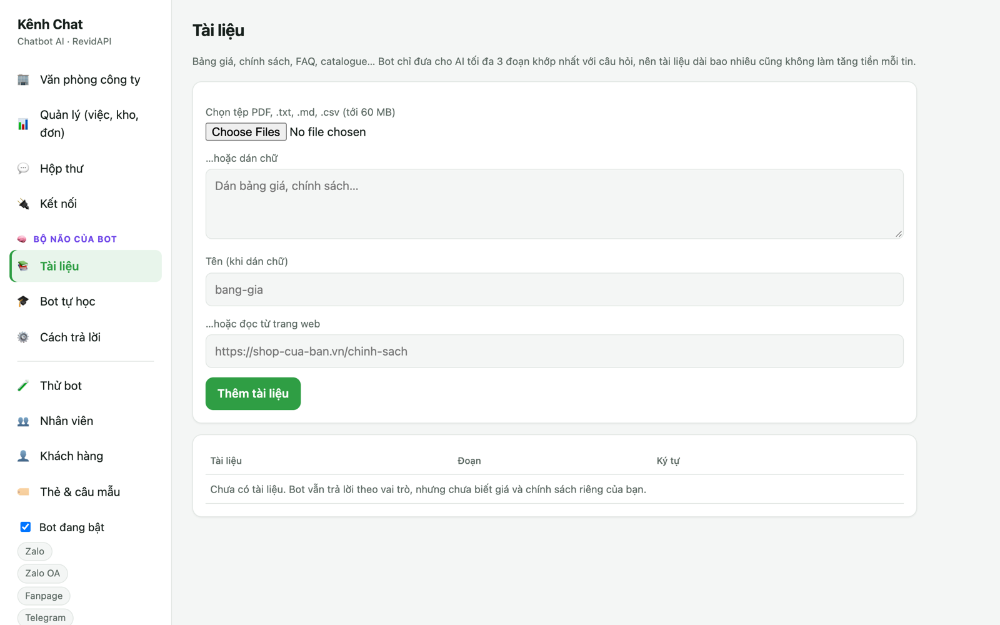
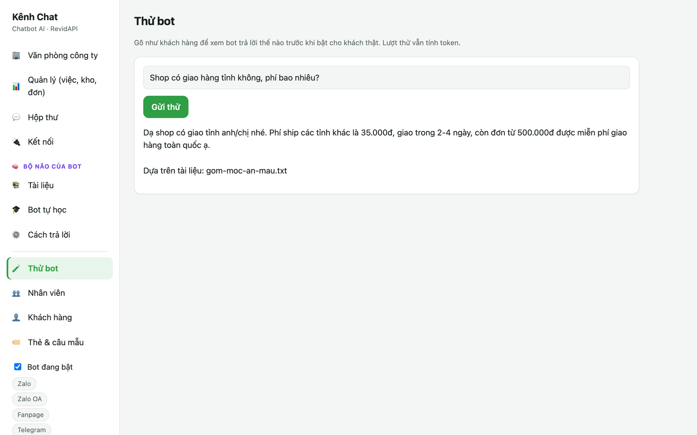
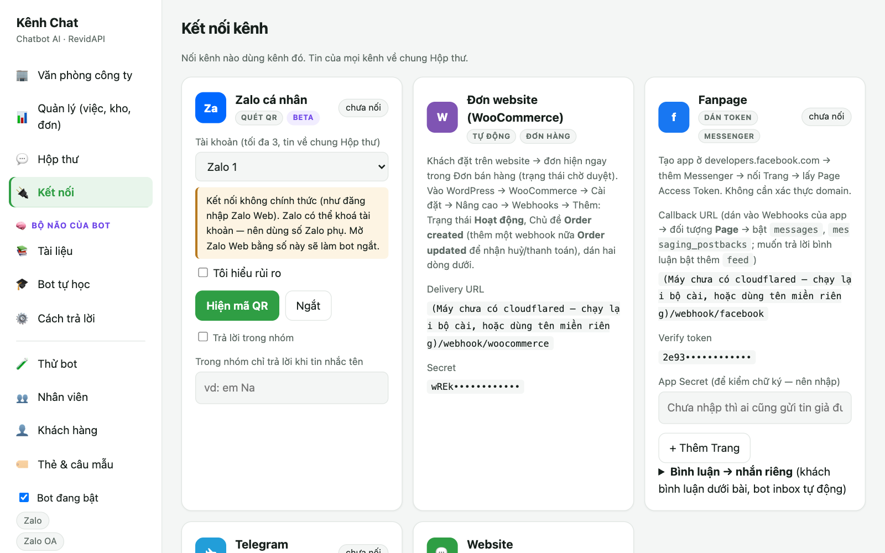
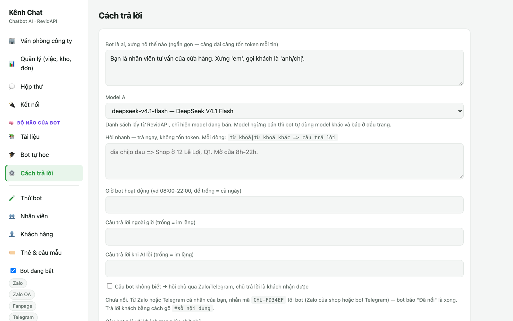

# Cài đặt Kênh Chat

Kênh Chat chạy được ở bốn nơi: VPS, Mac, Windows, hoặc chạy thẳng từ mã nguồn. Cách nào cũng cần **API key RevidAPI** vì bot trả lời qua RevidAPI. Lấy key ở [revidapi.com/dashboard/settings](https://revidapi.com/dashboard/settings) (dạng `sk_...`).

| Chạy ở đâu | Hợp với ai | Bot chạy 24/7? |
|---|---|---|
| VPS Ubuntu/Debian | Shop cần bot trả lời cả đêm | Có |
| Mac / Windows | Thử trước, hoặc máy luôn bật | Chỉ khi máy bật |
| Từ mã nguồn | Lập trình viên muốn sửa code | Tuỳ bạn |

> Đừng dán key vào nhóm chat, issue GitHub hay ảnh chụp màn hình. Ai có key là tiêu được credit của bạn. Nên đặt trần chi tiêu theo ngày cho key ở trang quản lý key.

---

## 1. VPS Ubuntu / Debian (khuyên dùng)

Cần: VPS 1 GB RAM trở lên, quyền root.

```bash
curl -fsSL https://revidapi.com/tai-app/kenh-chat.sh | sudo bash -s -- sk_khoa_cua_ban
```

Lệnh này:

1. Cài Node.js 22 riêng ở `/opt/kenh-chat-node` (không đụng Node có sẵn trên máy).
2. Chép mã vào `/opt/kenh-chat`, dữ liệu ở `/opt/kenh-chat/data` (quyền 600).
3. Tạo dịch vụ systemd `kenh-chat`, tự chạy lại khi VPS khởi động.
4. In ra **địa chỉ trang quản trị** và **mật khẩu**.

Có tên miền riêng thì gắn HTTPS (Caddy tự xin chứng chỉ). Trỏ bản ghi A của tên miền về IP VPS trước rồi chạy:

```bash
sudo bash /opt/kenh-chat/dat-ten-mien.sh chat.tenmien.vn 8790
```

Lệnh quản lý hằng ngày:

```bash
sudo systemctl status kenh-chat      # xem đang chạy không
sudo journalctl -u kenh-chat -n 100  # xem log
sudo systemctl restart kenh-chat     # khởi động lại
```

Quên mật khẩu: mở `/opt/kenh-chat/data/cau-hinh.json`, trường `matKhau`.

## 2. Mac

```bash
curl -fsSL https://revidapi.com/tai-app/kenh-chat-mac.sh | bash -s -- sk_khoa_cua_ban
```

- Cài vào `~/.revidapi/kenh-chat`, tự chạy khi đăng nhập (LaunchAgent).
- Tự tải `cloudflared` để mở đường HTTPS tạm cho Fanpage/Zalo OA. Telegram và Zalo cá nhân không cần đường này.
- Mở trang quản trị ở `http://localhost:8790`.

## 3. Windows

Mở **PowerShell** (không cần quyền Administrator) và dán:

```powershell
$env:REVIDAPI_KEY="sk_khoa_cua_ban"; irm https://revidapi.com/tai-app/kenh-chat-windows.ps1 | iex
```

- Cài vào `%LOCALAPPDATA%\RevidAPI\kenh-chat`.
- Tự chạy ẩn khi đăng nhập Windows (thư mục Startup của bạn).
- Mở trang quản trị ở `http://localhost:8790`.

## 4. Chạy từ mã nguồn

Cần Node.js 22.5 trở lên.

```bash
git clone https://github.com/revidapicom/revidapi-kenh-chat.git
cd revidapi-kenh-chat
npm install
REVIDAPI_KEY=sk_khoa_cua_ban MAT_KHAU=matkhau_cua_ban npm start
```

Không truyền `REVIDAPI_KEY` cũng được: mở trang quản trị, bot sẽ hỏi key trước khi cho dùng.

Biến môi trường:

| Biến | Mặc định | Ý nghĩa |
|---|---|---|
| `REVIDAPI_KEY` | (trống) | API key RevidAPI. Có thể nhập trên trang thay vì đặt ở đây |
| `MAT_KHAU` | tự sinh | Mật khẩu trang quản trị. Tự sinh thì xem trong `data/cau-hinh.json` |
| `CONG` | `8790` | Cổng trang quản trị |
| `KENH_DATA` | `./data` | Thư mục chứa token kênh, tài liệu, lịch sử chat |
| `WEBHOOK_GOC` | (trống) | Cách cũ để khai tên miền HTTPS (vd `https://chat.tenmien.vn`). Nay sửa thẳng trên trang quản trị |
| `KHONG_DUONG_HAM` | (trống) | Đặt `1` để không tự mở đường HTTPS tạm bằng cloudflared |

---

## Sau khi cài: 5 bước cho bot chạy

**Bước 1. Đăng nhập** bằng mật khẩu installer in ra.



**Bước 2. Nhập API key.** Chưa có key hợp lệ thì trang dừng ở đây, bot không trả lời ai.



**Bước 3. Cho bot đọc tài liệu**: bảng giá, chính sách giao hàng, câu hỏi hay gặp. Nhận PDF, DOCX, TXT, hoặc link trang web.



**Bước 4. Thử bot** trước khi nối kênh thật. Hỏi đúng câu khách hay hỏi, xem bot trả lời có lấy từ tài liệu không.



**Bước 5. Nối kênh.** Kênh nào dùng thì nối kênh đó:



| Kênh | Cần gì |
|---|---|
| Telegram | Nhắn @BotFather → `/newbot` → dán token. Xong |
| Zalo cá nhân | Bấm "Hiện mã QR", quét bằng Zalo. **Dùng số phụ**, Zalo có thể khoá tài khoản tự động |
| Fanpage | Tạo app ở developers.facebook.com, lấy Page Access Token, dán Callback URL + Verify token trên trang. Cần HTTPS |
| Zalo OA | Dán token OA + webhook. Cần HTTPS |
| Website | Dán 1 dòng `<script>` trước `</body>` |
| WooCommerce | Tạo webhook Order created/updated, dán Delivery URL + Secret. Cần HTTPS |

"Cần HTTPS" nghĩa là Facebook/Zalo phải gọi được tới máy bạn qua internet. Trên VPS thì gắn tên miền (mục 1). Trên Mac/Windows, Kênh Chat tự mở đường tạm bằng cloudflared; đường tạm đổi địa chỉ mỗi lần khởi động lại, nên dùng lâu dài thì chuyển lên VPS.

## Chọn model AI

Vào **Cách trả lời** để chọn model. Danh sách lấy trực tiếp từ RevidAPI. Mặc định là `deepseek-v4.1-flash`, rẻ và trả lời trong 3–5 giây. Model ngừng bán thì bot tự chuyển sang model khác và báo trên trang.



## Gỡ lỗi thường gặp

| Hiện tượng | Cách xử lý |
|---|---|
| Thử bot báo "bot chưa trả lời được: HTTP 401" | Key sai hoặc đã đổi. Nhập lại key ở trang quản trị |
| "... HTTP 402" | Hết credit. Nạp thêm ở revidapi.com |
| Bot trả lời chung chung, không theo giá của shop | Chưa có tài liệu, hoặc tài liệu không có câu đó. Thêm vào mục Tài liệu |
| Fanpage không nhận tin | Callback URL phải là HTTPS và đúng Verify token; app Facebook phải bật `messages` |
| Zalo cá nhân tự ngắt | Mở Zalo Web bằng cùng số sẽ đá phiên của bot. Đăng xuất Zalo Web rồi quét QR lại |
| Trang quản trị không mở được trên VPS | Mở cổng 8790 trên tường lửa, hoặc gắn tên miền rồi vào bằng HTTPS |

## Cập nhật

Trang quản trị có nút **Cập nhật** khi có bản mới: tải mã mới, giữ nguyên thư mục `data/`, rồi khởi động lại. Chạy từ mã nguồn thì `git pull && npm install` rồi chạy lại.

## Gỡ cài đặt

- VPS: `sudo systemctl disable --now kenh-chat`, rồi xoá `/opt/kenh-chat` và `/opt/kenh-chat-node` (thư mục `data/` chứa token và lịch sử chat, sao lưu trước nếu cần).
- Mac: `launchctl unload ~/Library/LaunchAgents/com.revidapi.kenhchat.plist`, rồi xoá `~/.revidapi/kenh-chat`.
- Windows: xoá `RevidAPI Kenh Chat.vbs` trong thư mục Startup, rồi xoá `%LOCALAPPDATA%\RevidAPI\kenh-chat`.
